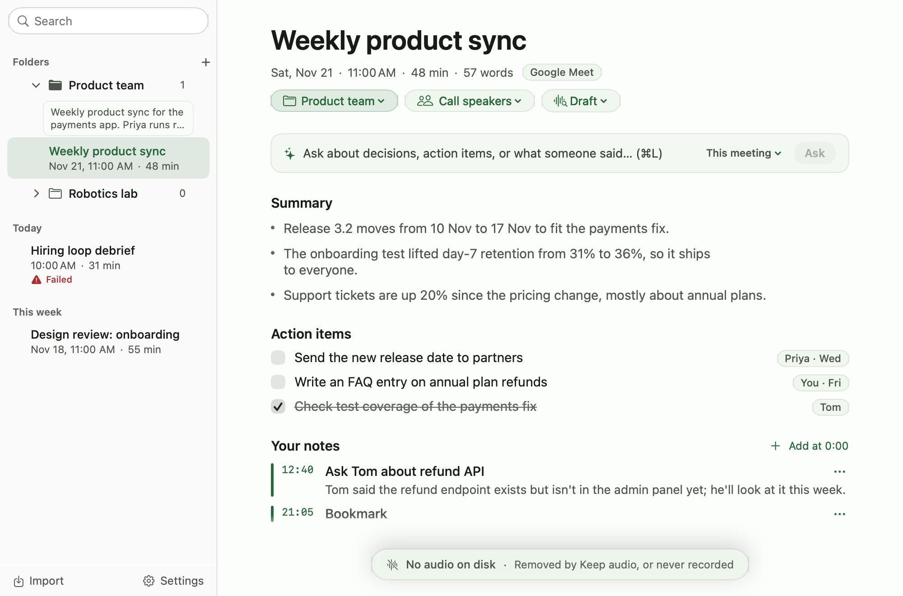

<p align="center"></p>

<h1 align="center">ReMeet</h1>

<p align="center">A meeting recorder for macOS that transcribes on your Mac.<br>It records your microphone and the call as two tracks, labels who spoke, and writes a transcript and summary.</p>

<p align="center">
  <picture>
    <source media="(prefers-color-scheme: dark)" srcset="docs/images/meeting-dark.png">
    
  </picture>
</p>

## Why

Phone recorders stop working the moment you put headphones in, because the other side of the
call never reaches the phone's microphone. ReMeet captures the call audio on the Mac itself, next
to your mic, so it works with AirPods and with any meeting app. Speech recognition and speaker
labels run locally with open models. There is no account, no server and no subscription.

## What it does

**Recording**

- Starts from the menu bar or with <kbd>⌥</kbd><kbd>⌘</kbd><kbd>R</kbd>. Your mic and the call
  audio are saved as separate tracks, so your voice is always labelled as you.
- Follows the input device your meeting app is using, and can capture audio from meeting apps
  only, leaving music and notifications out.
- Offers to record a minute before a calendar meeting, and when Zoom, Teams, FaceTime, Slack,
  Webex, Discord or a browser call turns the microphone on. The recording takes the event's name.
- Stops by itself when the call ends, after a 10 second countdown you can cancel.
- Imports existing audio files through the same pipeline.

**Notes while you talk**

- A small floating pill shows the timer and levels. Click it, or press
  <kbd>⌥</kbd><kbd>⌘</kbd><kbd>N</kbd>, to type a note. <kbd>Return</kbd> saves a note,
  <kbd>⌘</kbd><kbd>Return</kbd> saves an action item, and an empty <kbd>Return</kbd> drops a
  bookmark. Notes are timestamped and appear in the transcript and summary.
- Automatically hides the pill when Zoom, Teams, or macOS screen sharing starts, and lets you
  hide or show it anytime with <kbd>⌥</kbd><kbd>⌘</kbd><kbd>H</kbd> (or disable the pill in
  Settings and use the menu bar + <kbd>⌥</kbd><kbd>⌘</kbd><kbd>N</kbd> on demand).

<p align="center">
  <picture>
    <source media="(prefers-color-scheme: dark)" srcset="docs/images/note-dark.png">
    
  </picture>
</p>

**After the meeting**

- Each recording is compressed, split by speaker, transcribed and summarized. Processing resumes
  where it left off, and a failed step never deletes audio.
- Click any word in the transcript to play from there. Summary lines jump to the moment they
  came from.
- Name a voice once and ReMeet suggests that name in later meetings.
- Ask questions about one meeting, a folder, or everything you have recorded
  (<kbd>⌘</kbd><kbd>L</kbd>). Answers cite the passages they came from.
- **Copy for AI** (<kbd>⇧</kbd><kbd>⌘</kbd><kbd>C</kbd>) puts the whole meeting on the clipboard
  as Markdown, ready to paste into any assistant.
- **Auto-export Markdown for AI agents** (<kbd>⇧</kbd><kbd>⌘</kbd><kbd>E</kbd>): each folder can
  point to a local directory on disk where ReMeet automatically writes and updates clean `.md`
  files (YAML frontmatter, folder context, notes, summary, checkbox action items, and full
  transcript) so tools like Claude Code or Cursor can read meeting context directly from disk.
- Folders group meetings by team or project. Each folder has a context note that is passed to
  its summaries.

## Models

Everything is downloaded once on first launch, about 5.5 GB in total, into
`~/Library/Application Support/ReMeet/Models`.

| Stage | Model | Runs on |
|---|---|---|
| Speaker labels | pyannote community-1 with WeSpeaker embeddings, via [FluidAudio](https://github.com/FluidInference/FluidAudio) | Core ML |
| Transcription, Fast | NVIDIA Parakeet TDT 0.6B v2, about 25 seconds per hour of audio | Core ML |
| Transcription, Accurate | Cohere Transcribe 03-2026 (2B, 8-bit), about 3 minutes per hour | MLX |
| Summary and chat | Qwen3 4B Instruct (4-bit), or any model you load in LM Studio | MLX or local HTTP |

Transcription is English only.

## What leaves your Mac

Audio never does. Recording, speaker labels and speech recognition are entirely local, and
meetings are plain files in `~/ReMeet/meetings`.

There is one optional exception for text. If the [Claude Code](https://claude.com/claude-code)
command line tool is installed and signed in, ReMeet uses it to send the transcript text to
Claude Sonnet, which fixes misheard words and writes the summary. This uses your own Claude
login. ReMeet does not read or store any API key. Without Claude Code installed, or if the call
fails, the on-device transcript and the local summary model are used and nothing is sent anywhere.

The only other network traffic is the model download from Hugging Face on first launch.

## Requirements

- Apple silicon Mac with macOS 26 or later. It is tuned for a base M4 with 16 GB of memory.
- Xcode 26 or later to build it.

## Install

There is no prebuilt download yet, so you build it yourself. Xcode needs its Metal toolchain for
the MLX shaders; if the build complains, run `xcodebuild -downloadComponent MetalToolchain` once.

```bash
git clone https://github.com/moizfakhri/ReMeet.git
cd ReMeet
scripts/install.sh
```

`install.sh` makes a Release build, copies it to `/Applications` and opens it. On first launch
ReMeet asks for microphone and system audio access, then downloads the models. You can record
straight away while they download.

The build is signed ad-hoc by default. That is fine for running it, but macOS ties privacy
permissions to the signature, so it will ask for microphone and system audio access again after
every rebuild. To keep them, create a self-signed code signing certificate named
`ReMeet Local Signing` in Keychain Access (Certificate Assistant, Create a Certificate, type
Code Signing). `build.sh` picks it up automatically.

You can also open `ReMeet.xcodeproj` in Xcode and run the `ReMeet` scheme after choosing your own
signing team.

## Development

```bash
scripts/build.sh                                # Release build into build/
swift test --package-path Packages/ReMeetKit    # unit tests
scripts/selftests.sh                            # in-app self-tests against the Release build
```

```
ReMeet/               App: capture, processing pipeline, SwiftUI views
Packages/ReMeetKit/   Non-UI logic and its unit tests
Config/               Info.plist, entitlements, bridging header
Design/               App icon source (Icon Composer)
scripts/              Build, install, performance and self-test scripts
docs/                 Performance measurements and README images
```

A meeting is a folder: `~/ReMeet/meetings/<date>_<time>_<title>/` holding the audio plus JSON
and Markdown for notes, transcript and summary. To move your history to a new Mac, copy
`~/ReMeet/` (`index.sqlite` and `chunks.sqlite` rebuild automatically on launch). Measured CPU,
memory and processing times are in [docs/performance.md](docs/performance.md), and the full
history of changes and benchmarks is in [CHANGELOG.md](CHANGELOG.md).

## Status

This is a personal project that I use daily, shared as is. It has been tested on one machine, an
M4 MacBook Pro on macOS 27. Expect rough edges on other setups, and please open an issue if you
hit one.

## Acknowledgements

[FluidAudio](https://github.com/FluidInference/FluidAudio),
[MLX Swift](https://github.com/ml-explore/mlx-swift),
[mlx-audio-swift](https://github.com/Blaizzy/mlx-audio-swift),
[swift-transformers](https://github.com/huggingface/swift-transformers),
[GRDB](https://github.com/groue/GRDB.swift) and
[KeyboardShortcuts](https://github.com/sindresorhus/KeyboardShortcuts).

## License

[MIT](LICENSE)
