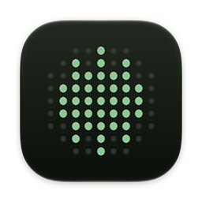
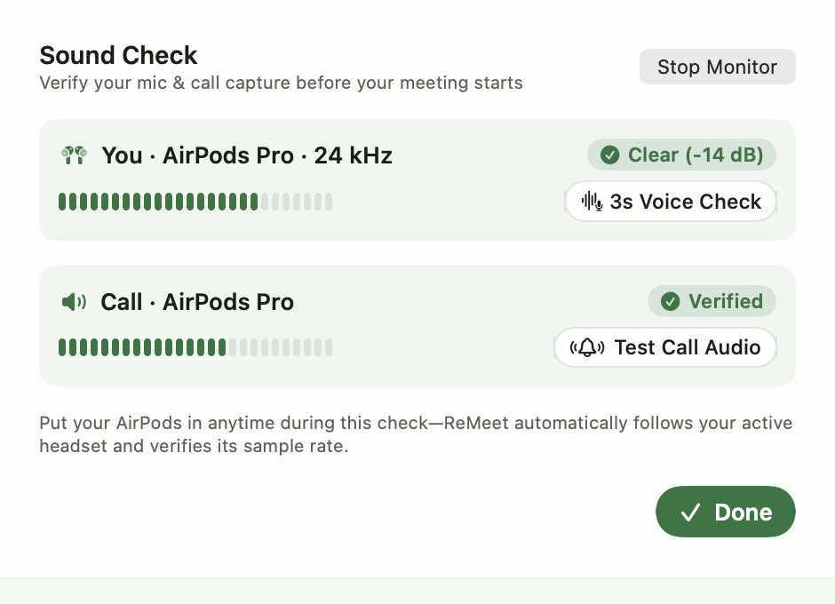
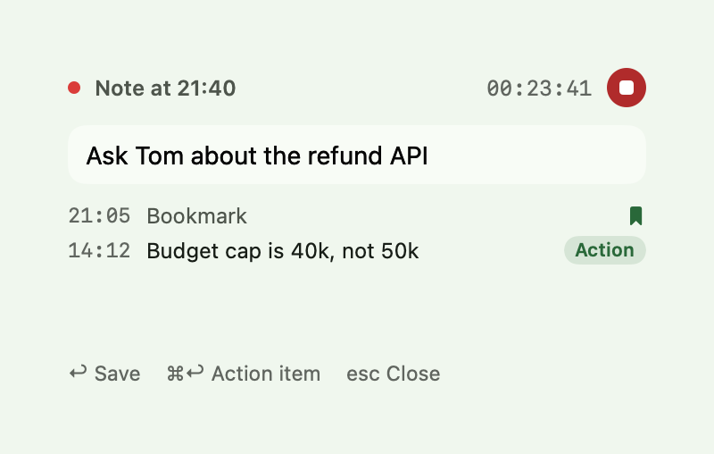
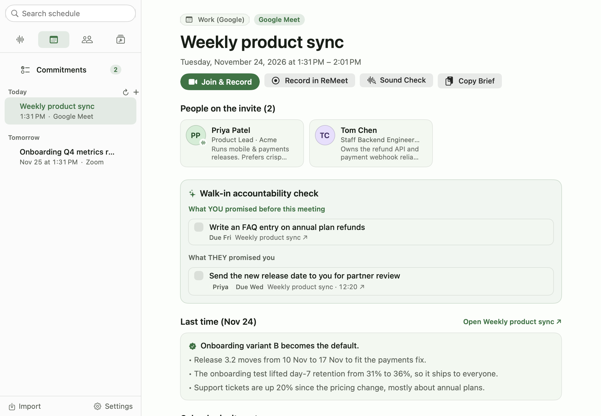
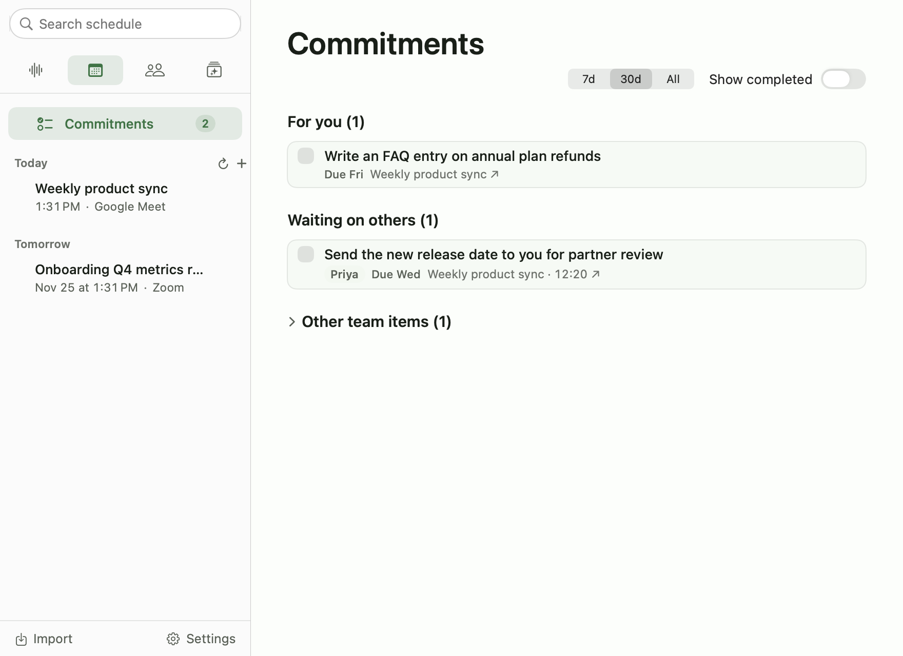
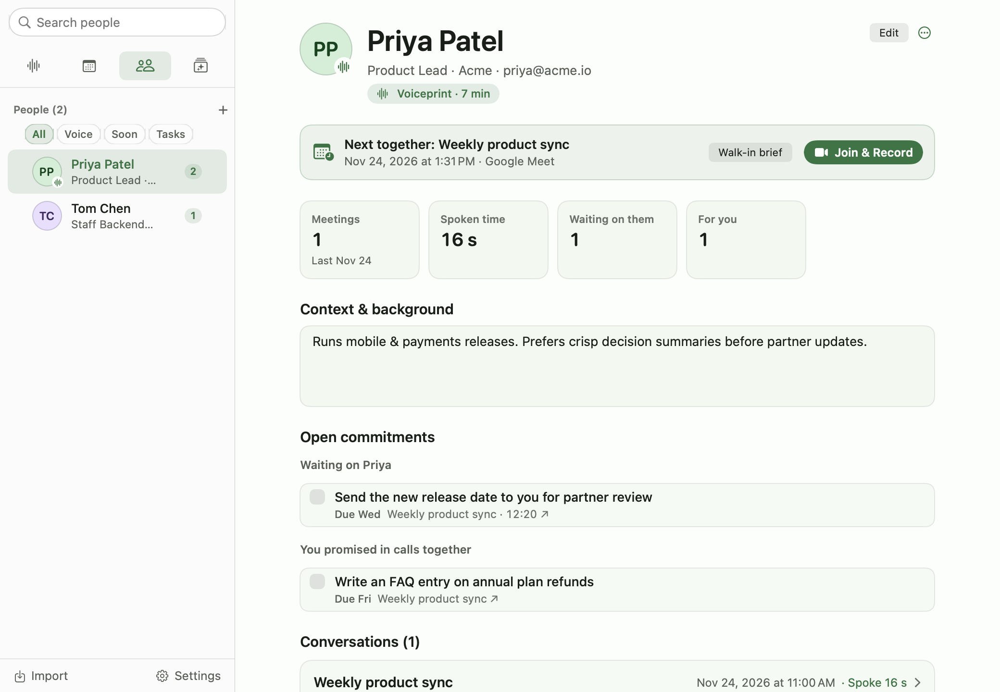
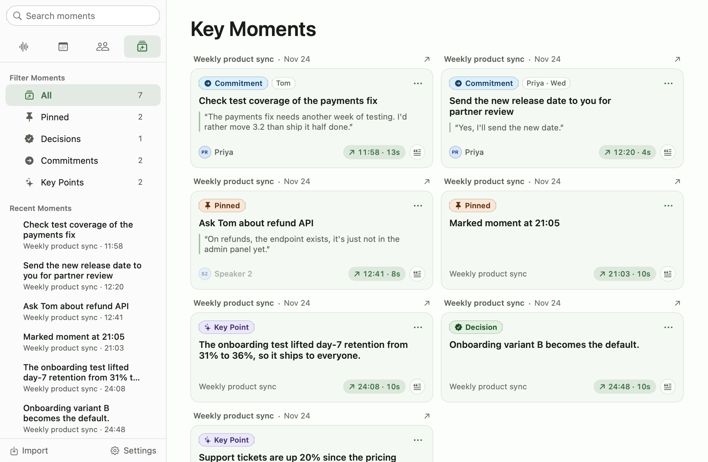

<p align="center"></p>

<h1 align="center">ReMeet</h1>

<p align="center">A local-first meeting recorder and memory hub for macOS.<br>It records your microphone and the call as two tracks, tracks people and commitments, surfaces Key Moments, and transcribes &amp; summarizes on your Mac.</p>

<p align="center">
  <picture>
    <source media="(prefers-color-scheme: dark)" srcset="docs/images/meeting-dark.png">
    
  </picture>
</p>

## Why

Phone recorders stop working the moment you put headphones in, because the other side of the
call never reaches the phone's microphone. ReMeet captures the call audio on the Mac itself, next
to your mic, so it works with AirPods and with any meeting app. Speech recognition, speaker
embeddings, Key Moments, people profiles, and search run locally with open models. There is no
account, no server and no subscription.

## What it does

**Recording & audio safety**

- Starts from the menu bar or with <kbd>⌥</kbd><kbd>⌘</kbd><kbd>R</kbd>. Your mic and the call
  audio are saved as separate tracks, so your voice is always labelled as you.
- Follows the active input device (switching seamlessly between AirPods, Bluetooth headsets, USB
  mics, and your Mac's built-in mic) and can capture audio from meeting apps only, leaving music and
  notifications out.
- **Pre-call Sound Check:** live mic and call-audio level meters with a sample-rate readout, 3-second
  mic test, and call-audio loopback check directly from the menu bar or upcoming meeting cards.
- **Live silent-recording guardrails:** continuously checks recording health and surfaces clear menu
  bar and pill warnings for an OS-muted mic, flatlined dead input, stalled Bluetooth streams,
  blocked call capture, or call-app mic mismatches.
- Reminds you a minute before online calendar meetings (filtering out classes and physical-only
  blocks) across **14 call platforms**: Zoom, Teams, Google Meet, Webex, FaceTime, Slack Huddle,
  Discord, Amazon Chime, GoTo Meeting, Whereby, Jitsi, RingCentral, BlueJeans, and Gather, and
  starts/stops automatically when a call uses the microphone.
- Imports existing audio files preserving original file creation dates, with editable meeting
  date &amp; time in the header.

<p align="center">
  <picture>
    <source media="(prefers-color-scheme: dark)" srcset="docs/images/sound-check-dark.png">
    
  </picture>
</p>

**Notes while you talk**

- A compact floating pill shows the timer and levels. Click it, or press
  <kbd>⌥</kbd><kbd>⌘</kbd><kbd>N</kbd>, to type a note. <kbd>Return</kbd> saves a note,
  <kbd>⌘</kbd><kbd>Return</kbd> saves an action item, and an empty <kbd>Return</kbd> drops a
  bookmark. Notes are timestamped and woven into Key Moments, the transcript, and the summary.
- Automatically hides the pill when Zoom, Teams, or macOS screen sharing starts (without requiring
  Screen Recording permission), and lets you hide or show it anytime with
  <kbd>⌥</kbd><kbd>⌘</kbd><kbd>H</kbd>.

<p align="center">
  <picture>
    <source media="(prefers-color-scheme: dark)" srcset="docs/images/note-dark.png">
    
  </picture>
</p>

**Schedule, Walk-In Prep &amp; Commitments**

- **Calendar sync:** combines Apple Calendar (EventKit) with subscribed Google, Outlook, and iCloud
  `.ics` feeds, deduplicated and filtered to actual online meetings so classes and desk blocks never
  clutter your schedule.
- **Week &amp; Month Calendar with Smart Focus:** shows your schedule in an interactive 7-day
  **Week** strip or **Month** grid, automatically focusing on **This Week** on workdays and
  switching to **Upcoming Week** on weekends once remaining calls finish, with day-click filtering,
  **Action items to focus on** grouped under each upcoming call, and one-click
  **Sync This Week / Upcoming Week to Reminders**.
- **Two-Way Apple Reminders Sync:** syncs action items via native EventKit (staying updated
  across Mac, iPhone, iPad, and Apple Watch via iCloud Reminders) with 4-tier list routing
  (per-item, per-meeting, per-folder / automatic ReMeet folder mirroring into matching Reminders
  lists that you can group under a `Work` folder in Apple Reminders, and global default),
  one-click whole-folder sync, natural-language due-date parsing, and `remeet://` deep links back
  to the exact meeting timestamp.
- **Walk-In Pre-Meeting Prep Brief:** opens before any recurring or invitee-matched meeting with
  one-click **Join &amp; Record**, attendee cards, **Last time** decisions/summary recap, open
  questions, and a mutual accountability check before you walk in.
- **Commitments Radar:** aggregates open action items across meetings and elevates **For you** and
  **Waiting on others** above collapsed **Other team items**, with `7d` / `30d` / `All` recency
  filters, hover actions, and one-click dismissal.

<p align="center">
  <picture>
    <source media="(prefers-color-scheme: dark)" srcset="docs/images/schedule-dark.png">
    
  </picture>
</p>

<p align="center">
  <picture>
    <source media="(prefers-color-scheme: dark)" srcset="docs/images/commitments-dark.png">
    
  </picture>
</p>

**People &amp; voiceprints**

- **People directory (`~/ReMeet/people.json`):** builds profiles automatically from speaker names
  and calendar invites—deduplicating Teams/Outlook/Zoom `"Last, First [Middle]"` and ALL-CAPS
  invite names, honorifics (`Dr.`/`Prof.`), and manual speaker labels with readable aliases and
  one-click merge suggestions for ambiguous first names—while tracking meeting counts, spoken
  time, voiceprint hours, free-form context notes, and shared open commitments per person.
- **Smarter voice matching &amp; turn fixes:** matches WeSpeaker embeddings across meetings with
  calendar-invite ranking, tracks per-meeting voiceprint contributions so fixing a mislabelled
  speaker cleanly unlearns the wrong vector, and lets you click any turn or speaker chip to
  assign **This turn** vs **All turns** or split out a new speaker (1–12 call speakers).

<p align="center">
  <picture>
    <source media="(prefers-color-scheme: dark)" srcset="docs/images/people-dark.png">
    
  </picture>
</p>

**Key Moments, Conversation Pulse &amp; Highlight Reel**

- **Key Moments:** interactive visual cards (Pinned, Decisions, Commitments, Key Points) shown inside
  each meeting and across your whole library in the **Moments** tab, with one-click jump to audio or
  transcript and sequential **Highlight Reel** playback.
- **Conversation Pulse:** clickable speaker talk-share timeline dotted with moment pins showing
  each participant's speaking share and meeting pace.

<p align="center">
  <picture>
    <source media="(prefers-color-scheme: dark)" srcset="docs/images/moments-dark.png">
    
  </picture>
</p>

**After the meeting &amp; AI workflows**

- Resumable local processing: compress, speaker-diarize, transcribe, and summarize without ever
  deleting audio on failure.
- Fast `NSTextView` transcript in a user-resizable split pane (<kbd>⌘</kbd><kbd>T</kbd>) that tracks
  window width down to narrow 3-column layouts, with click-to-play words and instant
  <kbd>⌘</kbd><kbd>F</kbd> find.
- Ask questions about one meeting, a folder, or everything you have recorded
  (<kbd>⌘</kbd><kbd>L</kbd>) with hybrid SQLite FTS5 + embedding search and timestamped citations.
- One-click **Follow-up** email composer, **Copy for AI** (<kbd>⇧</kbd><kbd>⌘</kbd><kbd>C</kbd>),
  and **Auto-export Markdown for AI agents** (<kbd>⇧</kbd><kbd>⌘</kbd><kbd>E</kbd>) per folder
  so tools like Claude Code or Cursor can read meeting context straight from disk.

## Models

Everything is downloaded once on first launch, about 5.5 GB in total, into
`~/Library/Application Support/ReMeet/Models`.

| Stage | Model | Runs on |
|---|---|---|
| Speaker labels | pyannote community-1 with WeSpeaker embeddings, via [FluidAudio](https://github.com/FluidInference/FluidAudio) | Core ML |
| Transcription, Fast | NVIDIA Parakeet TDT 0.6B v2, about 25 seconds per hour of audio | Core ML |
| Transcription, Accurate | Cohere Transcribe 03-2026 (2B, 8-bit), about 3 minutes per hour | MLX |
| Summary and chat | Qwen3 4B Instruct (4-bit), or any model you load in LM Studio | MLX or local HTTP |

Transcription is English only.

## What leaves your Mac

Audio never leaves your Mac. Recording, speaker labels, speech recognition, Key Moments, people
profiles, and search run locally, and meetings live as plain files in `~/ReMeet/meetings`.

Three optional features run outside pure local files only when you opt in:

- **Claude Code text pass:** if the [Claude Code](https://claude.com/claude-code) CLI is installed
  and signed in, ReMeet sends transcript text to Claude Sonnet for spelling cleanup and summaries
  using your own Claude login (zero API keys stored; falls back to the local MLX model offline).
- **Subscribed calendar feeds:** if you paste `.ics` feed URLs in Schedule or Settings, ReMeet
  fetches read-only calendar events directly from those URLs to power reminders, attendee hints,
  and Walk-In Prep Briefs.
- **Apple Reminders sync:** if you grant Reminders access, ReMeet reads and writes action items via
  local macOS EventKit (which syncs across your Apple devices only if iCloud Reminders is enabled on
  your Mac; nothing is sent to third-party servers).

The only other network traffic is the initial model download from Hugging Face on first launch.

## Requirements

- Apple silicon Mac with macOS 26 or later. It is tuned for a base M4 with 16 GB of memory.
- Xcode 26 or later to build it.

## Install

There is no prebuilt download yet, so you build it yourself. Xcode needs its Metal toolchain for
the MLX shaders; if the build complains, run `xcodebuild -downloadComponent MetalToolchain` once.

```bash
git clone https://github.com/moizfakhri/ReMeet.git
cd ReMeet
scripts/install.sh
```

`install.sh` makes a Release build, copies it to `/Applications` and opens it. On first launch
ReMeet asks for microphone and system audio access, then downloads the models. You can record
straight away while they download.

The build is signed ad-hoc by default. That is fine for running it, but macOS ties privacy
permissions to the signature, so it will ask for microphone and system audio access again after
every rebuild. To keep them, create a self-signed code signing certificate named
`ReMeet Local Signing` in Keychain Access (Certificate Assistant, Create a Certificate, type
Code Signing). `build.sh` picks it up automatically.

You can also open `ReMeet.xcodeproj` in Xcode and run the `ReMeet` scheme after choosing your own
signing team.

## Development

```bash
scripts/build.sh                                # Release build into build/
swift test --package-path Packages/ReMeetKit    # unit tests
scripts/selftests.sh                            # in-app self-tests against the Release build
scripts/privacy-check.sh --all                  # scan tracked files & commit emails for private data
git config core.hooksPath .githooks             # enable pre-commit & pre-push privacy hooks
```

```
ReMeet/               App: capture, processing pipeline, SwiftUI views
Packages/ReMeetKit/   Non-UI logic and its unit tests
Config/               Info.plist, entitlements, bridging header
Design/               App icon source (Icon Composer)
scripts/              Build, install, performance and self-test scripts
docs/                 Performance measurements and README images
```

A meeting is a folder: `~/ReMeet/meetings/<date>_<time>_<title>/` holding the audio plus JSON
and Markdown for notes, transcript and summary, alongside `~/ReMeet/people.json` and
`~/ReMeet/voiceprints.json`. To move your history to a new Mac, copy `~/ReMeet/`
(`index.sqlite` and `chunks.sqlite` rebuild automatically on launch). Measured CPU, memory and
processing times are in [docs/performance.md](docs/performance.md), and the full history of
changes and benchmarks is in [CHANGELOG.md](CHANGELOG.md).

## Status

This is a personal project that I use daily, shared as is. It has been tested on one machine, an
M4 MacBook Pro on macOS 27. Expect rough edges on other setups, and please open an issue if you
hit one.

## Acknowledgements

[FluidAudio](https://github.com/FluidInference/FluidAudio),
[MLX Swift](https://github.com/ml-explore/mlx-swift),
[mlx-audio-swift](https://github.com/Blaizzy/mlx-audio-swift),
[swift-transformers](https://github.com/huggingface/swift-transformers),
[GRDB](https://github.com/groue/GRDB.swift) and
[KeyboardShortcuts](https://github.com/sindresorhus/KeyboardShortcuts).

## License

[MIT](LICENSE)
